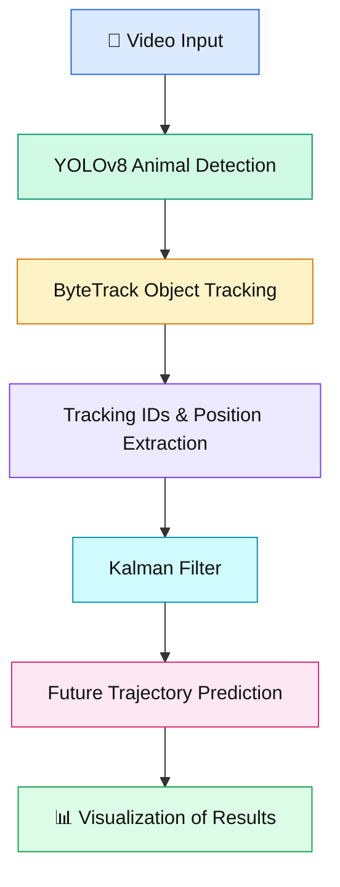

# 🐾 Animal-Aware Tracking System

### AI-Powered Animal Detection, Multi-Object Tracking & Trajectory Prediction for Road Safety

<p align="center">
  
  
  
  
  
</p>

---

## 🌍 About the Project

The **Animal-Aware Tracking System** is a computer vision-based project designed to detect and track animals in video streams and predict their future movement.

By combining YOLOv8, ByteTrack, and Kalman Filter techniques, the system analyzes animal movement across consecutive video frames.

The project explores how AI-powered animal detection and trajectory prediction can contribute to intelligent transportation systems and help improve road safety.

## 🐄 Why This Project?

Animals crossing or moving along roads can create unexpected road-safety challenges.

This project explores the use of artificial intelligence and computer vision to:

- Identify animals in video streams.
- Track their movement across frames.
- Maintain consistent tracking identities.
- Estimate future animal positions.
- Support research into animal-aware road safety systems.

## 🖼️ Project Inspiration

<p align="center">
  
  
</p>

<p align="center">
  <i>Illustrative animal-road scenarios relevant to the project.</i>
</p>

## 🚀 Key Features

| Feature                  | Description                                       |
| ------------------------ | ------------------------------------------------- |
| 🐄 Animal Detection      | Detects animals using YOLOv8.                     |
| 🎯 Object Tracking       | Tracks multiple objects using ByteTrack.          |
| 🆔 Tracking IDs          | Maintains object identities across frames.        |
| 📍 Movement Analysis     | Analyzes animal positions and movement patterns.  |
| 🔮 Trajectory Prediction | Estimates future positions using a Kalman Filter. |
| 🎥 Video Processing      | Processes video inputs and visualizes results.    |

## 🧠 Technologies Used

- Python
- YOLOv8
- OpenCV
- PyTorch
- ByteTrack
- Kalman Filter
- Jupyter Notebook

## ⚙️ System Workflow



## 🐾 Animal Categories

The project focuses on the following animal categories:

- Cow
- Sheep
- Dog

*Detection capabilities depend on the classes supported by the selected YOLOv8 model.*

## 💻 Installation & Setup

### 1. Clone the Repository

```bash
git clone YOUR_GITHUB_REPOSITORY_URL
cd Animal-Aware-Tracking-System
```

### 2. Install Dependencies

```bash
pip install -r requirements.txt
```

### 3. Launch Jupyter Notebook

```bash
jupyter notebook
```

### 4. Run the Project

1. Open the project notebook.
2. Execute the notebook cells.
3. Provide a compatible video input.
4. Observe animal detection, tracking, and trajectory prediction results.

## 🔬 Development Environment

| Component        | Configuration    |
| ---------------- | ---------------- |
| Operating System | Windows 11       |
| Processor        | Intel Core i5    |
| RAM              | 16 GB            |
| Python           | 3.12.7           |
| PyTorch          | 2.7.0+cpu        |
| Ultralytics      | 8.3.0            |
| Environment      | Jupyter Notebook |
| Hardware         | CPU              |

## 🔮 Future Enhancements

- Real-time animal detection and tracking.
- Risk-zone identification.
- Automated collision-warning mechanisms.
- Improved trajectory prediction.
- Integration with roadside surveillance cameras.
- Performance evaluation using additional tracking metrics.

## 🌐 Potential Applications

- Intelligent Transportation Systems
- Wildlife Monitoring
- Animal Movement Analysis
- Road Safety Research
- Smart Surveillance

## 👨‍💻 Author

### Keerthan Diwakar

Interested in Artificial Intelligence, Machine Learning, Deep Learning, and Computer Vision.

---

<p align="center">
  <b>Building smarter and safer roads with Artificial Intelligence. 🚀</b>
</p>

<p align="center">
  ⭐ If you find this project interesting, consider giving it a star!
</p>
